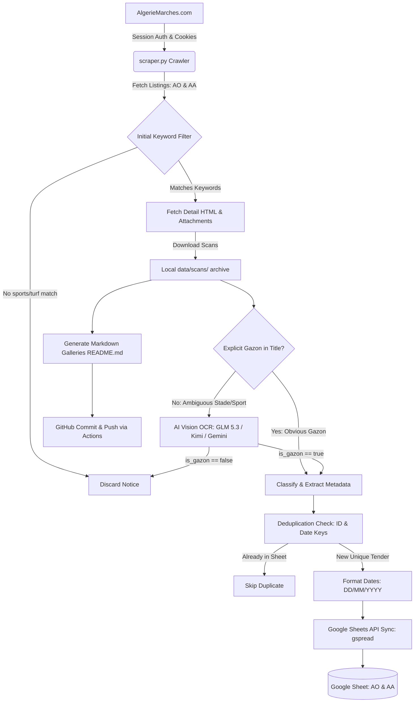

# 🤝 Handover Document: AlgerieMarches Scraper & Analyzer (TAPIDOR)

*Document prepared on October 22, 2026 for seamless handoff to Claude and team developers.*

---

## 1. Executive Summary & Current Health

* **Target Application**: Production scraper & AI document analysis system for **TAPIDOR** (Algeria's sports turf & synthetic lawn specialist).
* **Target Source**: [AlgerieMarches.com](https://algeriemarches.com) (tenders, consultations, and contract awards across all 58 Algerian wilayas).
* **Delivery Destination**: Google Sheet `APPELS-DOFFRE-AVIS-DATTRIBUTION-2026-GAZON` (ID: `1y5-OxNeL_zBhCUNNEVoh1nKZVsyBYrq5EJcgKBEt920`).
* **Automation**: GitHub Actions workflow (`.github/workflows/scraper.yml`) runs daily at **07:00 UTC (08:00 AM Algerian Time)**.
* **Current Operational Status**:
  * ✅ Remote GitHub Actions runs are healthy and passing daily (commits `da59443` through `bd2edcb`).
  * ✅ Google Sheets tabs (`APPEL D'OFFRE 2026` and `AVIS D'ATTRIBUTIONS 2026`) are audited, properly aligned, and deduplicated.
  * ✅ Unit test suite in `tests/` passes with 100% test coverage for classifiers, date normalizers, and deduplication logic (`python -m unittest discover tests -v`).

---

## 2. Recent Bug Fixes & System Evolution

### A. The AO Deduplication Bug (Fixed in `da59443`)
* **Problem**: In early October 2026, two legitimate sports turf tenders were silently dropped by the scraper:
  * Notice `85018` (Commune of Es-Senia, Wilaya of Oran): Realization of two proximity stadiums in synthetic turf.
  * Notice `93574` (Wilaya of Tamanrasset): Lot 3 – Realization of a synthetic turf sports ground.
* **Root Cause**: The Google Sheets sync function `append_to_gsheet()` indexed existing rows using:
  ```python
  norm_loc = ("NORM_LOC", norm_wilaya, norm_commune)
  ```
  If *any* tender in that commune had ever been recorded earlier in the year (even months prior), the scraper unconditionally dropped any new tender from that commune for the rest of 2026.
* **Resolution**: Removed the date-less `norm_loc` check. Deduplication now strictly checks:
  1. The 5–6 digit Notice ID (`ann_id`) tracked across all cell values and formulas.
  2. Publication date match: `("AO_PARUTION", action, ptype, norm_w, norm_c, date_parution)`.
  3. Deadline match: `("AO_ECHEANCE", norm_w, norm_c, date_echeance)`.
* Both missed notices (`85018` and `93574`) were manually restored into Rows 255 and 256 of `APPEL D'OFFRE 2026`.

### B. Excel Date Serial Number Glitch
* **Problem**: Certain dates in `APPEL D'OFFRE 2026` were rendering as raw integer serial numbers (e.g., `46302` and `46306`) or `12/31/1899`.
* **Root Cause**: In Google Sheets configured for French/Algerian locale, unformatted ISO strings or numbers entered with default formats can be interpreted as day serial offsets from epoch.
* **Resolution**: Added `format_date_dmy()` to `scraper.py` ensuring all dates written to `APPEL D'OFFRE 2026` are formatted explicitly as `"DD/MM/YYYY"` strings before batch appending.

### C. Regex Grammar Catch in Facility Classification
* **Problem**: `classify_type_projet("Stade communal d'Oran")` was returning `"STADE"` instead of `"STADE COMMUNAL"`.
* **Root Cause**: The regex pattern `\bSTADES?\s+COMMUNAU?X?\b|\bSTADES?\s+COMMUNALES?\b` matched plural forms (`COMMUNAUX`, `COMMUNALES`) and feminine singular (`COMMUNALE`), but omitted the standard masculine singular form (`COMMUNAL` ending in `-L`).
* **Resolution**: Updated patterns in `scraper.py` and tests to:
  ```python
  ("STADE COMMUNAL", r"\bSTADES?\s+COMMUNAL(?:ES?|S)?\b|\bSTADES?\s+COMMUNAUX\b"),
  ("STADE MUNICIPAL", r"\bSTADES?\s+MUNICIPAL(?:ES?|S)?\b|\bSTADES?\s+MUNICIPAUX\b"),
  ```

### D. AI Model Cost & Accuracy Guardrails
* **Context**: User experienced sudden credit exhaustion when experimental Opus vision models were briefly triggered. Furthermore, Llama models caused frequent JSON extraction failures and hallucinated dates.
* **Current Golden Configuration**:
  ```python
  NVIDIA_MODEL = "z-ai/glm-5.3-flash"
  NVIDIA_FALLBACK_MODELS = [
      ("z-ai/glm-5.3-flash", 25),
      ("moonshotai/kimi-k3", 25),
  ]
  GEMINI_MODELS = ["gemini-2.5-flash", "gemini-2.0-flash", "gemini-1.5-flash"]
  ```
  * `glm-5.3-flash` and `kimi-k3` provide high-speed, accurate bilingual (French/Arabic) OCR without draining credits.
  * Never re-enable Llama or Opus models.

---

## 3. Architecture & Data Flow



### Component Breakdown
1. **Authentication Engine (`AlgerieMarchesScraper`)**:
   * Uses `requests.Session` with cookies cached in `state/cookies.json`.
   * Automatically verifies active session via `/api/ads/all` and executes full login flow with CSRF token if session has expired.
   * Promotes session to `sessionType: "normal"` to enable full scan and ad detail retrieval.
2. **Vision & OCR Pipeline (`analyze_scan`)**:
   * Automatically compresses images (`prepare_image_for_ocr`) to $< 350$ KB to ensure low-latency API execution.
   * Queries NVIDIA NIM endpoint (`https://integrate.api.nvidia.com/v1/chat/completions`) with structured JSON instructions.
   * Falls back to Google Gemini (`gemini-2.5-flash`) if NVIDIA key is absent or rates are exceeded.
3. **Google Sheets Sync (`append_to_gsheet`)**:
   * Authenticates using Service Account JSON (`state/service_account.json` or `GCP_SERVICE_ACCOUNT_KEY` secret).
   * Reads existing worksheet values, headers, and formulas to compute column offsets dynamically.
   * Tracks notice IDs embedded in scan hyperlinks and appends rows using `value_input_option="USER_ENTERED"`.

---

## 4. Suggested Roadmap & Enhancements for Claude

Here are concrete areas where Claude can add immediate value:

### 1. Package Modularization (Refactoring `scraper.py`)
Currently, `scraper.py` is a single file of ~1,600 lines containing configuration, classification regexes, vision clients, Google Drive sync, Google Sheets sync, and scraping logic.
* **Suggested Structure**:
  ```text
  algeriemarches/
  ├── __init__.py
  ├── config.py           # Environment variables, constants, regexes
  ├── auth.py             # Session management, cookies, CSRF, login
  ├── classifiers.py      # Action, project type, commune, and budget extractors
  ├── vision.py           # NVIDIA NIM & Gemini Vision OCR pipeline
  ├── sheets.py           # Google Sheets sync & deduplication
  ├── crawler.py          # Listing & detail page scraping
  └── cli.py              # CLI argument parser and entry point
  ```

### 2. CI/CD Automated Test Gate
* Add a test step into `.github/workflows/scraper.yml` prior to the scraping step:
  ```yaml
  - name: Run Unit Tests
    run: python -m unittest discover tests -v
  ```
  This ensures any accidental breakage of regexes or date formatters prevents broken runs from touching production sheets.

### 3. Notification Webhook (Discord / Telegram)
* TAPIDOR management would benefit from instant notifications whenever a new high-priority tender or contract award is discovered.
* Adding a lightweight webhook utility (`send_discord_alert(item)`) in `append_to_gsheet` would deliver real-time alerts with project name, wilaya, budget, and scan link.

### 4. Robust Rate-Limiting & Backoff
* While `time.sleep(0.5)` is in place, implementing an exponential backoff decorator (e.g., `tenacity` or custom retry loop) for detail page fetches will safeguard against occasional 429 / 503 drops by AlgerieMarches.

---

## 5. Quick Reference for Claude Prompts

When prompting Claude for future work on this repository, you can say:
* *"Claude, check `CLAUDE.md` and `HANDOVER.md` for our business rules and Google Sheets contracts."*
* *"Refactor `scraper.py` into modular components under `src/algeriemarches/` while keeping all existing tests passing."*
* *"Add a Discord webhook integration that posts new synthetic turf awards to our internal channel."*
